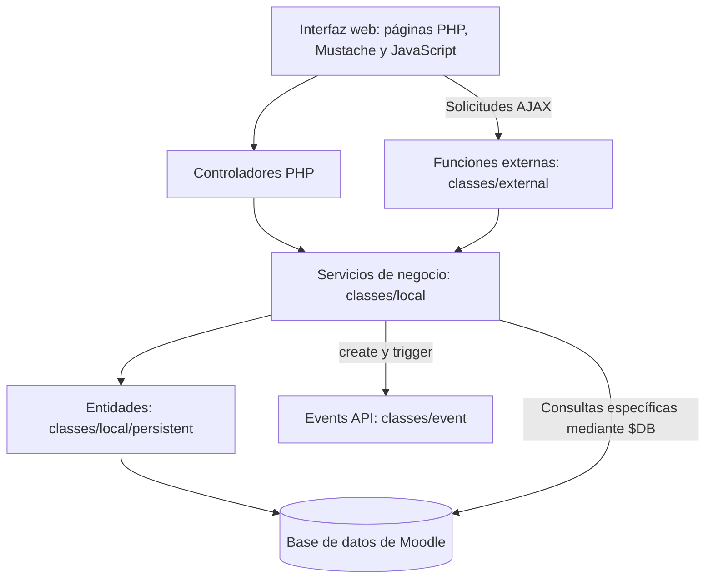
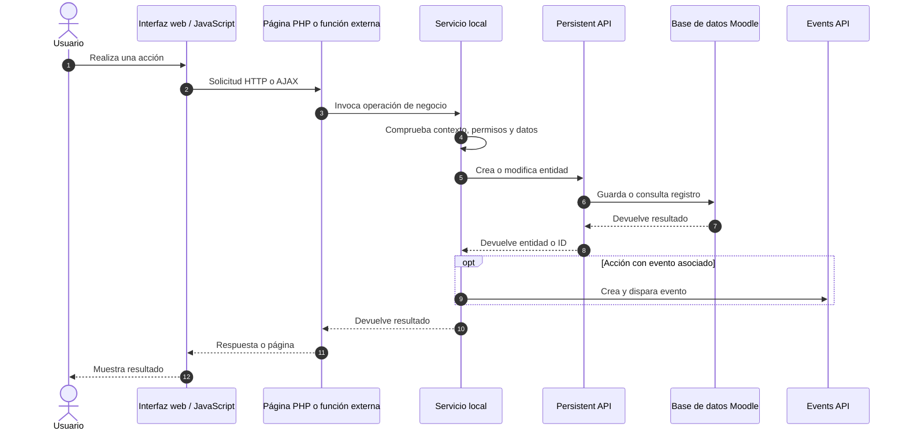

# Arquitectura de servicios y persistencia de ChuspaSocial

## 1. Objetivo

Este documento describe la arquitectura del plugin local `local_chuspasocial` para Moodle, con énfasis en los servicios de negocio, las entidades de la Persistent API, los eventos y el recorrido de las solicitudes desde las páginas PHP y las funciones externas utilizadas por AJAX hasta la base de datos.

Complementa `docs/arquitectura.md` y `docs/modelo-datos.md` sin reemplazarlos.

## 2. Organización por capas

- **Presentación y controladores:** las páginas PHP procesan solicitudes y muestran información. Las plantillas Mustache y los módulos JavaScript se encargan de la interfaz y las interacciones.
- **Funciones externas (`classes/external/`):** exponen operaciones consumidas mediante AJAX o servicios web de Moodle; validan parámetros y preparan las respuestas.
- **Servicios locales (`classes/local/`):** centralizan permisos, validaciones y reglas de negocio. Son reutilizados desde páginas, funciones externas y pruebas.
- **Persistencia (`classes/local/persistent/`):** las entidades que extienden `\core\persistent` definen propiedades y representan registros de tablas del plugin. Sus operaciones de creación, consulta y actualización utilizan la infraestructura de datos de Moodle.
- **Eventos (`classes/event/`):** registran acciones relevantes a través de la Events API. Se crean y disparan desde los servicios cuando corresponde.

La Persistent API es el mecanismo principal para gestionar las entidades del dominio, pero algunos servicios también pueden realizar consultas específicas mediante `$DB`; por ello, no todas las lecturas pasan necesariamente por una instancia persistente.

## 3. Servicios centrales y entidades

| Servicio | Responsabilidades principales | Entidades relacionadas | Eventos relevantes |
|---|---|---|---|
| `post_service` | Crear, actualizar y eliminar publicaciones; verificar visibilidad y permisos; obtener muros general, de curso y personal | `persistent\post` | `post_created`, `post_deleted` |
| `comment_service` | Consultar y agregar comentarios; verificar acceso a la publicación | `persistent\comment` y `persistent\post` | `comment_created` |
| `listing_service` | Crear, buscar, actualizar y eliminar anuncios de libros; gestionar fotografías, cursos asociados y estado de venta | `persistent\listing`, `persistent\listing_course` | `listing_created` |

### 3.1. Publicaciones: `post_service`

Ubicación: `src/classes/local/post_service.php`.

- `create_post($courseid, $content, $format)` determina el contexto del sistema o del curso, verifica la capacidad `local/chuspasocial:post` y, para publicaciones de curso, exige inscripción activa.
- Crea un registro mediante la entidad `persistent\post`.
- Después de guardarlo, crea y dispara `post_created` con el ID del post, el contexto y el usuario autor.
- `update_post()` y `delete_post()` gestionan modificaciones y eliminación; `delete_post()` dispara `post_deleted`.
- `get_general_feed()`, `get_course_feed()` y `get_personal_feed()` proporcionan publicaciones para las distintas vistas.

### 3.2. Comentarios: `comment_service`

Ubicación: `src/classes/local/comment_service.php`.

- `get_comments($postid)` consulta los comentarios de una publicación.
- `add_comment($postid, $content)` incorpora un comentario después de aplicar las verificaciones correspondientes, incluida la visibilidad del post mediante `post_service::can_view()`.
- La creación del comentario dispara el evento `comment_created`.

### 3.3. Anuncios: `listing_service`

Ubicación: `src/classes/local/listing_service.php`.

- `create_listing($data)` registra un anuncio mediante `persistent\listing` y dispara `listing_created`.
- `search()` y `get_for_my_courses()` consultan anuncios.
- `update_listing()`, `mark_sold()` y `delete_listing()` gestionan el ciclo de vida del anuncio.
- `set_courses()` administra la vinculación entre anuncios y cursos mediante la entidad `persistent\listing_course`.
- `save_photos()` gestiona las fotografías asociadas al anuncio.

## 4. Entidades persistentes y modelo de datos

Las clases de `src/classes/local/persistent/` extienden la clase `persistent` de Moodle y definen sus propiedades con `define_properties()`.

| Entidad | Tabla de Moodle | Función |
|---|---|---|
| `post` | `local_chuspasocial_post` | Publicaciones del muro general o de un curso |
| `comment` | `local_chuspasocial_comment` | Comentarios asociados a publicaciones |
| `listing` | `local_chuspasocial_listing` | Anuncios de libros |
| `listing_course` | `local_chuspasocial_lstcourse` | Relación entre anuncios y cursos |
| `reaction` | `local_chuspasocial_reaction` | Reacciones a publicaciones |
| `follow` | `local_chuspasocial_follow` | Seguimiento de usuarios o etiquetas |
| `report` | `local_chuspasocial_report` | Reportes de contenido |

Las relaciones más relevantes son:

- `comment.postid` referencia la publicación comentada (`post.id`).
- `post.userid`, `comment.userid` y `listing.userid` identifican al usuario de Moodle responsable.
- `post.courseid` identifica el curso asociado; el valor `0` corresponde al muro general.
- `listing_course.listingid` y `listing_course.courseid` relacionan anuncios con cursos.

Para el detalle de campos y relaciones, consultar `docs/modelo-datos.md`.

## 5. Flujo desde controladores y AJAX hasta la base de datos

Este diagrama representa el patrón general, no un único endpoint: algunas operaciones son solo de lectura y no generan eventos; ciertas consultas se hacen directamente con `$DB`.

### Ejemplos de puntos de entrada

| Entrada | Servicio utilizado | Propósito |
|---|---|---|
| `src/index.php` | `post_service` | Mostrar el muro general |
| `src/classes/external/get_posts.php` | `post_service` | Obtener publicaciones mediante función externa |
| `src/classes/external/add_comment.php` | `comment_service` | Agregar comentarios desde una solicitud externa |
| `src/classes/external/get_listings.php` | `listing_service` | Consultar anuncios |
| `src/listing_edit.php` | `listing_service` | Crear o actualizar información de anuncios y sus cursos |
| `src/listing.php` | `listing_service` | Marcar anuncios como vendidos |
| `src/marketplace.php` | `listing_service` | Buscar y mostrar anuncios |

### Ejemplo concreto: creación de una publicación

En `post_service::create_post()`:

1. Se determina `context_system` si `courseid = 0`, o `context_course` si pertenece a un curso.
2. Se comprueba la capacidad para publicar y, en un curso, la inscripción activa.
3. Se instancia `persistent\post` con el usuario, curso, contenido, formato y marcas de tiempo.
4. Se guarda la publicación con `create()`.
5. Se crea `post_created` con `objectid`, `context` y `userid`, y se llama a `trigger()`.
6. El servicio devuelve la entidad creada.

## 6. Eventos del plugin

Los eventos se encuentran en `src/classes/event/` y extienden `\core\event\base`.

| Evento | Acción asociada |
|---|---|
| `post_created` | Creación de una publicación |
| `post_deleted` | Eliminación de una publicación |
| `comment_created` | Creación de un comentario |
| `listing_created` | Creación de un anuncio |
| `reaction_added` | Registro de una reacción |

Un evento puede contener `objectid` (ID del registro), `userid` (usuario que realizó la acción) y `context` (ámbito Moodle donde ocurrió). Su emisión permite que Moodle y sus observadores registren o reaccionen a la acción, sin trasladar las reglas de negocio a las clases de eventos.

## 7. Responsabilidades y mantenimiento

- Mantener las validaciones de negocio y permisos en los servicios, sin duplicarlas en cada controlador.
- Utilizar las entidades persistentes para el ciclo de vida de los registros y reservar `$DB` para consultas que lo requieran.
- Emitir eventos después de que la acción correspondiente se haya realizado correctamente.
- Reutilizar los servicios desde controladores PHP, funciones externas y pruebas automatizadas.
- Consultar `docs/arquitectura.md`, `docs/modelo-datos.md` y `docs/guia-eventos.md` para información complementaria.
